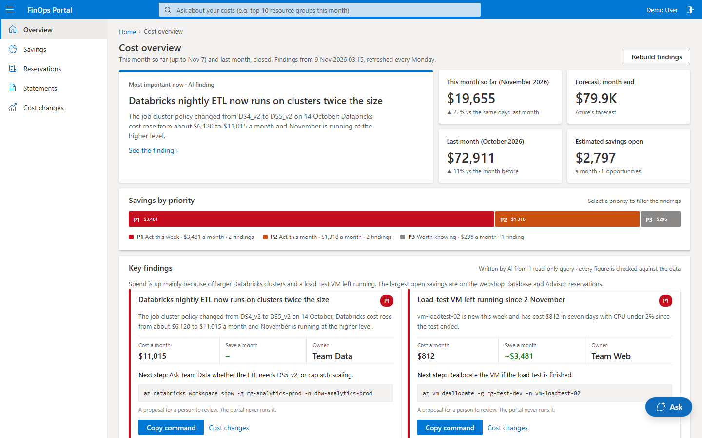
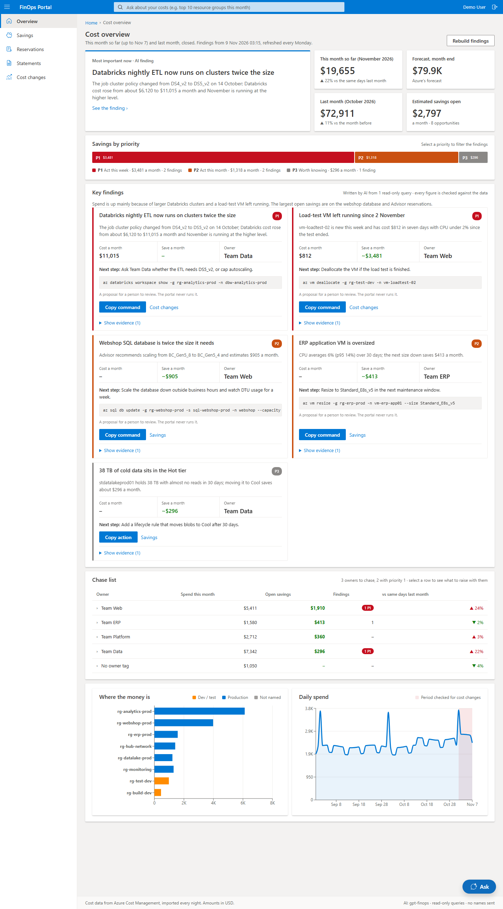
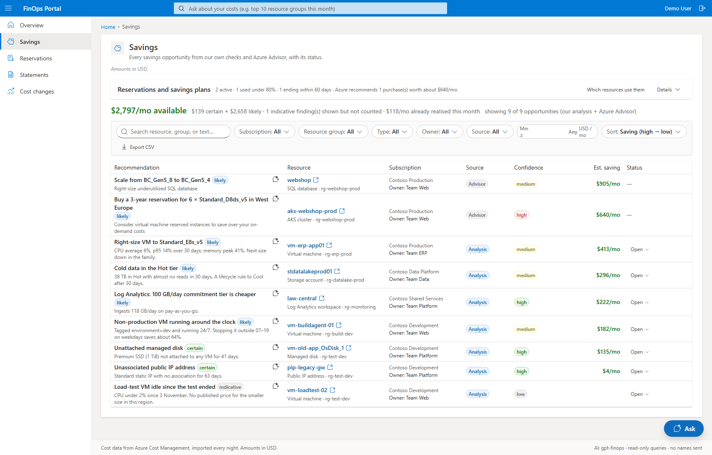
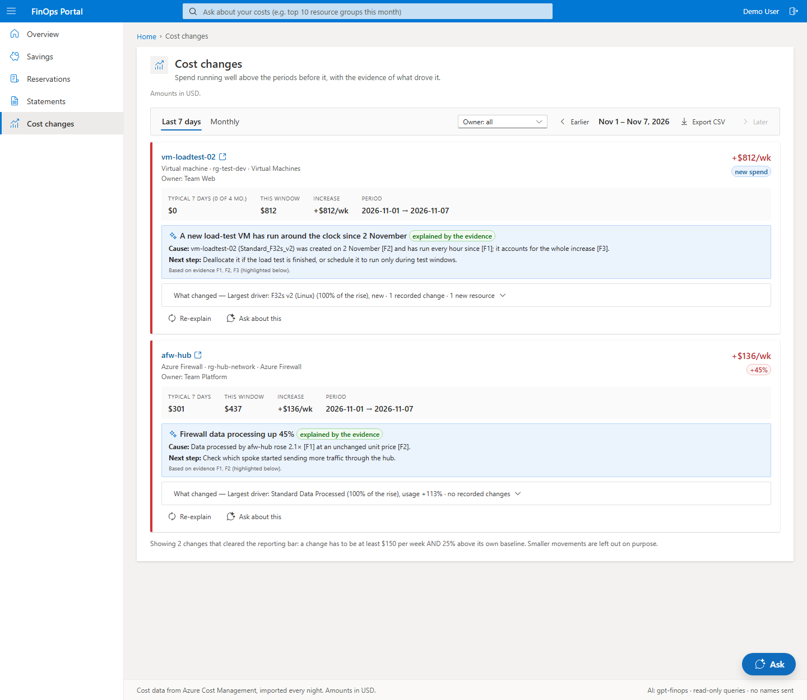
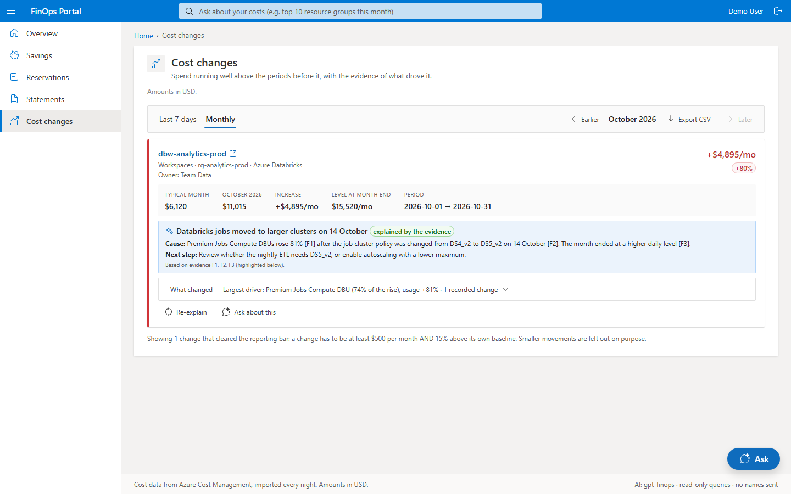
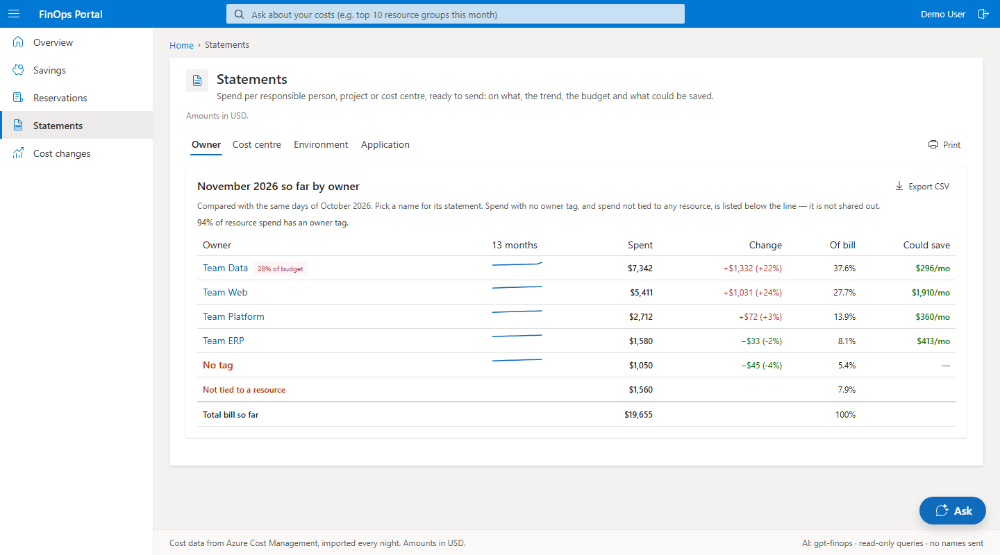
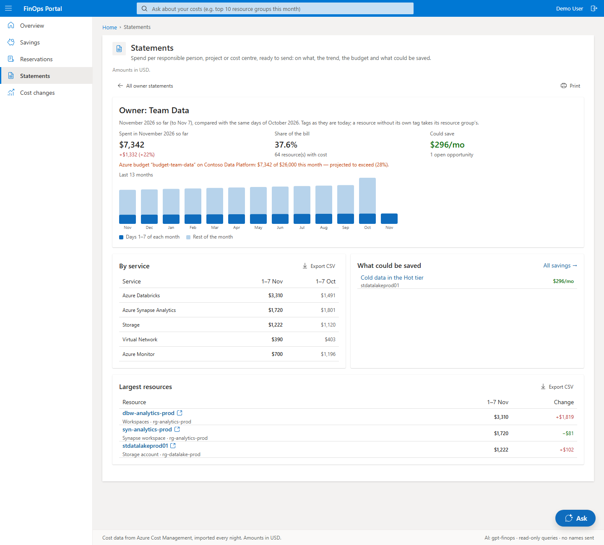
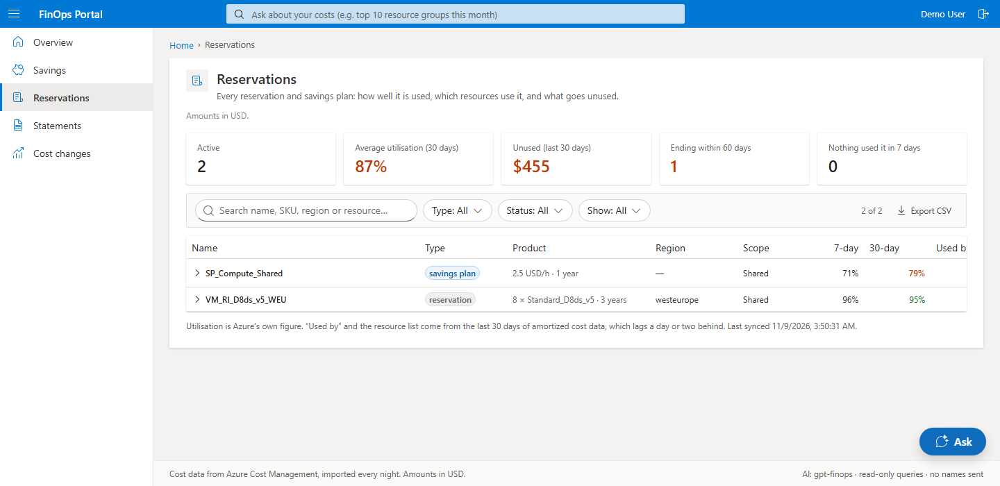

# Azure AI FinOps Portal

A **customer-hosted** FinOps portal for Azure. One page answers the question a platform / FinOps
team and management have every week or month: **what is going on cost-wise, who do we chase,
about what, and for how much.** Figures come from the tenant's own cost data; an **AI findings
agent on the customer's own provider (BYOK)** reads them, checks them with read-only queries and
writes prioritised findings.



## What it does

- **Overview** — one page, this month so far and last month (closed) side by side:
  - headline figures: this month vs the same days last month, forecast vs budget, last month vs
    the month before, estimated savings open;
  - **savings by priority** (P1 act this week, P2 this month, P3 worth knowing);
  - **3–6 key findings**, each with owner, monthly cost, estimated saving, a next step, a proposed
    Azure CLI / PowerShell command (shown, never run), its evidence and, for the portal's own
    savings, a status (open, in progress, done, dismissed);
  - a **chase list** per owner with their open savings and statement one click away — including
    "No owner tag" (which resource groups to tag first) and deleted resources;
  - spend per resource group (dev/test vs production) and the daily trend.
- **AI findings agent** (`CostAgent.psm1`) — every Monday (and on demand) it reads the computed
  payload — spend, the largest cost changes of the last 7 days and of last month, open savings,
  spend per owner and per resource group — and may run **read-only** tools to check and size what
  it sees. Owner names, subscription names and every GUID are replaced by tokens before anything
  reaches the model. A finding is kept only if it cites the data and every figure in it appears in
  the payload or a tool result. A missing owner tag can be a finding but never carries a saving;
  reservation and savings-plan purchases are billing-account decisions with no owner. Without AI
  the same payload is ranked by amount.
- **Ask** — a panel that slides in on every page (the **Ask** button, Ctrl/⌘+K, the header search
  box, or "Ask about this" on any item, which stays visible beside the answer): "top 10 resources
  in <subscription> this month", "which owner grew most compared with last month". Questions about resources, resource groups, subscriptions and owners, this month
  or last month, are answered instantly from the portal's own nightly per-resource cost; anything
  else (service, region, meter, trends) is a validated, read-only Cost Management query. The
  executed query is shown under every answer.
- **Cost changes with evidence** — nightly detection over a trailing week and complete months, at
  resource, meter and subscription level. For the largest changes the app works out which meters
  moved, whether usage or the unit price rose, and what was created, resized or deleted (Activity
  Log and Resource Graph change history).
- **Savings** — orphaned resources, right-sizing priced from the Azure Retail Prices API,
  non-production VMs running around the clock, cold data in Hot storage, Log Analytics on the
  wrong tier, unused reservation and savings-plan hours, and Azure Advisor. Tiered certain /
  likely / indicative; one saving per resource; Advisor purchase alternatives (1 or 3 years,
  several look-backs) count once; a resource with no cost for three days is left out.
- **Reservations** — every reservation and savings plan with Azure's utilisation and expiry, as on
  the Azure Reservations blade, plus what it doesn't show: **which resources used each one** over
  the last 30 days (amortized cost) and what went unused. Needs only Cost Management Reader.
- **Statements** — per owner or cost centre: this month so far, with a trend of up to 13 months
  that compares the same days of each month; ready to send; untagged and shared spend listed apart
  so the statements add up to the bill.
- **Language** — English (default) or Danish, chosen at deploy time (`deploy.ps1 -Language`);
  the currency follows it: USD in English, DKK in Danish.
- **Themes** — one folder each under `src/web-app/src/themes/`, chosen at deploy time:
  `azure-portal` (portal.azure.com style, light and dark) is the default; add your own branding
  as another folder (git-ignored by default, so it stays private). Delete a folder to remove a theme ([THEMES.md](THEMES.md)).
- **Subscription scope** — every subscription (default) or the ones you choose
  (`Setup/Set-SubscriptionScope.ps1`).

## Screenshots

All screenshots use made-up demo data (Contoso), in English with the default `azure-portal` theme.

| | |
|---|---|
| **Overview, full page** — headline figures, savings by priority, key findings, chase list, where the money is and the daily trend<br>[](docs/screenshots/overview-full.png) | **Savings** — every opportunity from the portal's own checks and Azure Advisor, with tier, owner and status<br>[](docs/screenshots/savings.png) |
| **Cost changes, last 7 days** — a new VM, explained from the evidence<br>[](docs/screenshots/cost-changes-week.png) | **Cost changes, monthly** — what drove the increase, and the level the month ended at<br>[](docs/screenshots/cost-changes-month.png) |
| **Statements** — spend per owner, with the trend and what could be saved<br>[](docs/screenshots/statements.png) | **One owner's statement** — 13-month trend, budget, services and largest resources<br>[](docs/screenshots/statement-owner.png) |
| **Reservations** — utilisation, expiry and which resources used each commitment<br>[](docs/screenshots/reservations.png) | |

## Design rules

- **Every figure the AI states comes from the data.** Arithmetic is in code (`CostAnalysis.psm1`,
  `CostEvidence.psm1`, `SavingsFinder.psm1`, `Brief.psm1`). The agent may only copy figures from
  the payload or from read-only tool results; a finding with any other figure is dropped
  (`Select-InsightFindings`, `Test-NarrativeGrounding`).
- **No names to the model.** Owners, subscription names and GUIDs are pseudonymised in the
  payload and in every tool result, and mapped back after the answer. Activity Log identities are
  pseudonymised too.
- **The AI never acts.** It has no write tool; proposed commands are text for a person to review.
- **Everything works without AI.** Figures, evidence, savings and ranked findings need no
  provider. AI use is capped per day (`AiDailyCallLimit`, `0` = off) and audited.

## Bring your own key (BYOK)

The customer supplies provider, endpoint, model and key (`Setup/Configure-AiProvider.ps1`), or, for
Azure OpenAI / Foundry, no key at all: `aiAuthMode=managedIdentity` lets the Function App's identity
sign in (needed behind a network security perimeter). Every
call goes through `AiAdapter.psm1`: `Invoke-AiCompletion` for single answers, `Invoke-AiAgent`
for the tool-calling findings agent.

| `AI_PROVIDER` | Covers |
|---|---|
| `openai` | OpenAI, **Azure OpenAI / Azure AI Foundry**, Mistral, Groq, Together, Ollama, vLLM, … |
| `anthropic` | Anthropic Messages API |

The key lives only in Key Vault; it is never in source, Bicep parameters or any API response.

## Architecture

Customer-hosted in **their own tenant** — the only data that leaves it is what the AI features
send to the provider the customer configured ([docs/security.md](docs/security.md#ai-data-flow)).
PowerShell Azure Functions (API + nightly timers) and a static React portal on a shared Linux App
Service Plan, Storage Tables and a queue, Application Insights and, only for a BYOK API key, Key Vault. The managed identity reads every
subscription it can see (granted at a management group).

```
Cost Management (per subscription) ─► cost-tasks queue (PlanCostIngest + ProcessCostTask) ─► CostSnapshots, daily totals
                                           │
   DetectCostSpikes  DetectSavings  SyncAdvisor  SyncCommitments  SyncMonthlyCosts  SyncAllocation
   (changes +        (own checks)   (Advisor)    (reservations)   (forecast,        (owners, groups,
    evidence)                                                      budgets)          statements,
                                                                                     per-resource cost)
                                           │
                                     BuildBrief-Timer ─► weekly payload + AI findings (CostAgent)
                                           │
Portal ◄── GetBrief, GetMonthOverview, GetCostTrend, GetSavings, GetStatement, GetCostSpikes,
           QueryCosts (Ask), RegenerateBrief, SetSavingsStatus, …
```

Cost Management does not answer management-group queries for CSP / Microsoft Customer Agreement
subscriptions. The nightly jobs therefore query each subscription, and Ask answers from the
stored per-resource cost where it can. Full dataflow: [docs/architecture.md](docs/architecture.md).

## Deploy

```powershell
az login
# Copy and fill in real values:
#   azResources/azuredeploy.parameters.dev.json -> azuredeploy.parameters.local.json
./deploy.ps1 -ResourceGroupName FinOpsPortal-dev -SubscriptionId <id> -ParametersFile azResources/azuredeploy.parameters.local.json
# Code only, another look:
./deploy.ps1 -ResourceGroupName FinOpsPortal-dev -SubscriptionId <id> -CodeOnly -Theme azure-portal
```

`deploy.ps1` deploys to any tenant or a throwaway RG. It runs the offline tests and `az bicep build`
first and deploys nothing if either fails. Pass `-SubscriptionId`: the Azure CLI keeps its own
default subscription, separate from Az PowerShell and the portal.

Needs: Azure CLI, PowerShell 7.2+ (`pwsh`), Node.js 22.12+.

Then run the post-deploy `Setup/` scripts (RBAC, AI provider, sign-in) —
[docs/setup-guide.md](docs/setup-guide.md).

> **The API is closed until sign-in is configured.** With no EasyAuth in front, every endpoint
> denies the caller (HTTP 403). Set `authClientId`, or opt into public mode explicitly with
> `allowAnonymousAccess: true`.

## Repository layout

```
azResources/      main.bicep + parameters
src/function-app/
  Modules/        AiAdapter (BYOK, agent loop, daily limit), CostAgent (findings agent),
                  Brief (weekly / monthly payload), CostAnalysis, CostEvidence, SavingsFinder,
                  CostIngest (queued per-subscription ingest), Allocation, Commitments, Fx,
                  ResourceNames, Text (en/da strings)
  *               one folder per function (function.json + run.ps1)
src/web-app/      React + Fluent UI v9 + Recharts, built to dist/; config.json at runtime
  src/pages/      Overview, Savings, Reservations, Statements, Cost changes (Spikes), Query (Ask)
  src/components/ shared pieces, including AskPanel (Ask on every page)
  src/themes/     one folder per theme
Setup/            post-deploy scripts (RBAC, AI provider, sign-in, scope, validate)
Tests/            offline tests — no Azure, no AI: pwsh ./Tests/Invoke-OfflineTests.ps1
Tools/            operational helpers (see Tools/README.md)
docs/             architecture, security, setup guide, screenshots
THEMES.md         how themes work
deploy.ps1        the deploy
```

## How this was built

The architecture and design were provided by the maintainer. That covers the customer-hosted,
BYOK model, the deterministic-figures / evidence-first AI rules, the pseudonymisation and the
single-page dashboard. The implementation was developed with
[Claude Code](https://claude.com/claude-code), Anthropic's AI coding assistant, working to that
design. Much of the code, tests and documentation was written with AI assistance. The offline tests and the deploy gate (`deploy.ps1` runs them before
anything is deployed) apply to all of it. Review it as you would any third-party code before
running it in your tenant.

> **Status:** the findings agent, Ask from stored cost and the themes are verified offline
> (tests, `npm run build`, `az bicep build`) and in
> a local preview with example data; check the findings after each rebuild against Cost analysis.
